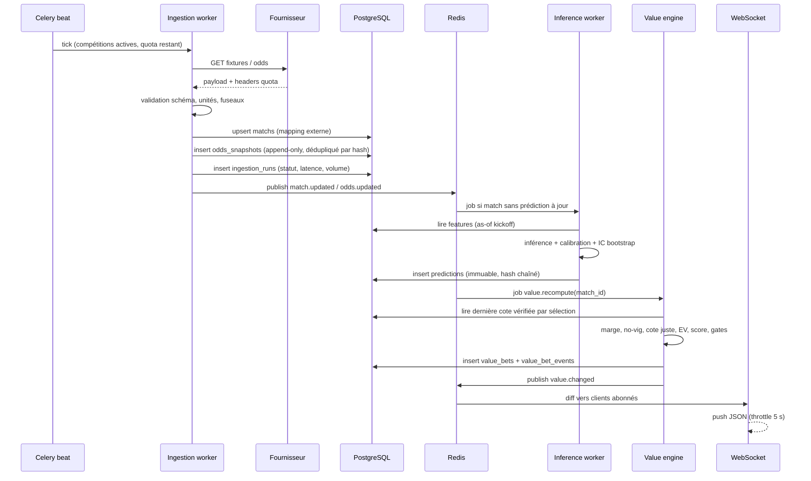

# 02 — Architecture technique

Version 1.0 — Phase 1. Toutes les décisions ci-dessous sont opposables aux phases suivantes.

---

## 1. Vue d'ensemble

```
                         ┌──────────────────────────────────────────────┐
                         │            ANDROID (Flutter)                 │
                         │  UI · Riverpod · go_router · Drift (cache)   │
                         │  Dio (REST) · WebSocket · FCM · Keystore     │
                         └───────────────┬──────────────────────────────┘
                                         │ HTTPS / WSS (TLS 1.2+)
                         ┌───────────────▼──────────────────────────────┐
                         │          NGINX / CADDY (reverse proxy)       │
                         │   TLS · rate limit · gzip · WAF basique      │
                         └───────┬───────────────────────┬──────────────┘
                                 │ /api/v1               │ /ws
                    ┌────────────▼───────────┐   ┌───────▼─────────────┐
                    │  FastAPI (API gateway) │   │ WebSocket gateway   │
                    │  auth · RBAC · cache   │   │ (pub/sub Redis)     │
                    └────┬──────────┬────────┘   └───────┬─────────────┘
                         │          │                    │
          ┌──────────────▼──┐   ┌───▼──────────┐   ┌─────▼──────────────┐
          │ PostgreSQL 16   │   │ Redis 7      │   │  Celery workers    │
          │ (source de      │   │ cache, locks │   │  ingestion · IA    │
          │  vérité)        │   │ files, pubsub│   │  value · notifs    │
          └──────────────▲──┘   └───▲──────────┘   └─────┬──────────────┘
                         │          │                    │
                         │     ┌────┴─────────┐   ┌──────▼─────────────┐
                         └─────┤ Celery beat  │   │  Model registry    │
                               │ (scheduler)  │   │  artefacts + meta  │
                               └──────────────┘   └──────┬─────────────┘
                                                         │
                              ┌──────────────────────────▼─────────────┐
                              │  Fournisseurs (adaptateurs isolés)     │
                              │  The Odds API · API-Football · FCM     │
                              │  Lonabet (manuel/partenaire)            │
                              └────────────────────────────────────────┘
```

**Principes**

1. **Le mobile ne calcule rien de métier.** Aucune probabilité, aucun EV, aucune marge n'est
   calculé dans Flutter. L'app affiche et met en cache des résultats serveur.
2. **Le serveur est la seule source de vérité.** Les fichiers locaux de l'app sont un cache
   remplaçable (Drift), jamais une base de référence.
3. **Chaque donnée est traçable** : source, horodatage de collecte, horodatage de validité,
   version de normalisation, score de confiance.
4. **Aucune donnée future** n'entre dans un calcul de prédiction ou un backtest.
5. **Dégradation gracieuse** : fournisseur indisponible → l'app affiche la dernière donnée
   valide avec un badge « périmée », jamais une donnée inventée.

---

## 2. Choix technologiques

| Couche | Technologie | Version cible | Pourquoi | Alternative écartée |
|---|---|---|---|---|
| Mobile | Flutter / Dart | stable au lancement, épinglée | Un seul code, Android only, performances natives | Kotlin natif (coût double si iOS un jour) |
| State | Riverpod 2 + `AsyncNotifier` | — | Testable, sans `BuildContext`, compile-safe | Provider (ancien), Bloc (verbeux) |
| Navigation | go_router | — | Deep links, guards d'auth, restauration | Navigator 1.0 |
| HTTP | Dio + intercepteurs | — | Retry, refresh token, logs masqués | http |
| Cache local | Drift (SQLite) | — | Requêtes, migrations, offline | Hive (pas relationnel) |
| Charts | fl_chart | — | Léger, suffisant | Syncfusion (licence) |
| Notifications | firebase_messaging + local | — | FCM + rappels locaux | OneSignal (coût) |
| API | FastAPI + Pydantic v2 | — | Async, OpenAPI natif, typage | Django (lourd), Flask (moins typé) |
| ORM | SQLAlchemy 2 async + Alembic | — | Migrations versionnées | Django ORM |
| DB | PostgreSQL 16 | 16 | ACID, JSONB, partitionnement, `pgcrypto` | MySQL (moins riche), Mongo (pas adapté aux cotes) |
| Cache/queue | Redis 7 + Celery 5 | — | Locks distribués, pub/sub, retries | RabbitMQ seul (pas de cache) |
| ML | scikit-learn, XGBoost, LightGBM, statsmodels, NumPy/SciPy | — | Standard, explicable, calibration éprouvée | Deep learning (données insuffisantes) |
| Registry | MLflow (optionnel) ou artefacts versionnés + table `model_versions` | — | Rollback, métadonnées | Git LFS seul |
| Monitoring | Prometheus + Grafana + Sentry + logs JSON | — | SLO, erreurs, traces | Solution SaaS coûteuse |
| Déploiement | Docker Compose sur Ubuntu 24.04 LTS, Caddy TLS | — | Simple, reproductible, suffisant < 50k users | Kubernetes (surdimensionné) |
| CI/CD | GitHub Actions (ou GitLab CI) | — | Tests, lint, build APK signé | Manuel |

**Interdit :** plateforme `web` dans le projet Flutter, dépendance à un CDN de cotes, clé API
dans le code Dart, calcul de probabilité côté client.

---

## 3. Modules backend

```
backend/
  app/
    core/            config, sécurité, logging, erreurs, timeouts
    db/              engine, session, modèles SQLAlchemy, migrations
    api/v1/          routers (auth, matches, predictions, value, favorites,
                     notifications, simulation, admin, ws)
    domain/          entités, value objects, règles métier pures (testables)
    providers/       adaptateurs fournisseurs (base.py + un fichier par source)
    ingestion/       normalisation, déduplication, validation, mapping
    features/        construction des variables par match (anti-fuite)
    models/          chargement, inférence, calibration, registry
    value/           marge, cote juste, EV, scoring, seuils, explications
    simulation/      bankroll, Kelly, règlement, ROI/CLV
    jobs/            tâches Celery (collecte, inférence, recalcul, notifications)
    realtime/        publication WebSocket, diff incremental
  tests/
```

**Règle de dépendance :** `api → domain ← value`, `providers → ingestion → domain`.
Le domaine ne connaît ni FastAPI, ni SQLAlchemy, ni Redis. Les formules de `value/` sont des
fonctions pures, testées sur des cas numériques documentés.

### Adaptateurs fournisseurs

Interface unique, pour pouvoir remplacer une source sans toucher au reste :

```python
class OddsProvider(Protocol):
    name: str
    async def fetch_odds(self, competition_ids: list[str], markets: list[str]) -> list[RawOdd]: ...
    async def health(self) -> ProviderHealth: ...
```

Chaque `RawOdd` porte `source`, `source_event_id`, `bookmaker`, `market`, `line`, `selection`,
`decimal_odds`, `observed_at`, `raw_payload_hash`. Aucune cote n'entre en base sans ces champs.

---

## 4. Flux de traitement

### 4.1 Ingestion → recommandation (pré-match)



### 4.2 Réévaluation d'une cote

Toute nouvelle cote déclenche, dans cet ordre :

1. déduplication (hash `source|event|bookmaker|market|line|selection|odds`) ;
2. détection de mouvement (delta, direction, vitesse) ;
3. recalcul de la probabilité implicite sans marge du marché ;
4. recalcul de l'EV et du score (pas de réinférence IA sauf si la composition officielle change) ;
5. écriture d'un **événement** de cycle de vie (`created`, `upgraded`, `downgraded`, `expired`,
   `withdrawn`) — l'ancien enregistrement n'est jamais modifié ;
6. notification si `A`/`B` nouveau ou changement de priorité, selon préférences.

### 4.3 Entraînement (hors ligne, jamais dans le chemin critique)

```
snapshot features (as-of)  ──► split chronologique (walk-forward, purge + embargo)
      │                                   │
      │                                   ├─► entraînement (train)
      │                                   ├─► calibration (validation)
      │                                   └─► test aveugle (holdout temporel)
      ▼
model_versions(status=candidate) ──► backtest complet ──► revue ──► status=active
                                                              └──► rollback possible
```

Un modèle ne passe `active` que si : ECE ≤ 0,05, pas de dégradation > 2 % du log loss vs version
active, et backtest walk-forward sans fuite. Le rollback est un simple changement de pointeur
`models.active_version_id`.

---

## 5. Temps réel (WebSocket)

- Endpoint `wss://host/ws?token=...` (token courte durée, jamais le refresh token).
- Canaux : `user:{id}` (notifications), `match:{id}` (cotes/score), `value:{competition}`.
- Message serveur : `{type, match_id, revision, ts, payload}` ; `revision` monotone permet de
  détecter une perte et de re-synchroniser via REST.
- **Throttle** : agrégation des deltas sur 5 s, pas de rafale.
- **Fallback** : si le WS échoue 2 fois, l'app passe en polling adaptatif (30–60 s) et affiche
  l'état « temps réel indisponible ».
- Aucune donnée sensible dans le canal public ; les cotes des bookmakers sont filtrées par pays
  autorisé pour l'utilisateur.

---

## 6. Architecture Flutter

Organisation **feature-first**, en couches :

```
lib/
  app/            bootstrap, thème, router, providers globaux
  core/           api_client, auth_store, erreurs, formats, widgets communs
  data/           dto (freezed/json), repositories, sources (remote/local)
  domain/         modèles UI, use cases (lecture seule)
  features/
    auth/ home/ matches/ match_detail/ value/ live/ favorites/
    history/ stats/ profile/ admin/ notifications/
  l10n/           fr (défaut), en (prêt)
```

- Chaque feature : `presentation/`, `application/` (notifiers), `data/`.
- `Repository` = source unique ; le cache Drift est consulté d'abord (stale-while-revalidate).
- Toutes les réponses API sont **versionnées** (`api_version`) et **datées** (`server_time`).
- Les montants sont des `Decimal` sérialisés en chaîne (jamais `double` pour l'argent).
- Timeouts : 10 s REST, 5 s WS handshake, retry exponentiel plafonné à 3.
- Aucun log de token, d'e-mail ou de cote nominative en clair.

### Responsive

| Largeur (dp) | Comportement |
|---|---|
| < 360 | cartes compactes, une colonne, typo -1 |
| 360–599 | référence (une colonne) |
| 600–839 | grille 2 colonnes sur l'accueil, fiche en 2 onglets visibles |
| ≥ 840 | liste-détail (master/detail) sur tablette, rail de navigation |

Le texte respecte `textScaleFactor` jusqu'à 1,3 sans troncature des libellés de priorité.

---

## 7. Données, cache, cohérence

| Donnée | Store | TTL | Stratégie |
|---|---|---|---|
| Matchs du jour | Redis + Drift | 60 s | stale-while-revalidate |
| Fiche match | Redis | 5 min | invalidation sur `match.updated` |
| Prédictions | PostgreSQL (immuable) + Redis | 30 min | clé = `match:version` |
| Cotes | PostgreSQL (partitionné) | 30 s | dernière cote vérifiée uniquement |
| Opportunités | PostgreSQL + Redis | 30 s | recalcul à chaque cote |
| Classements/stats équipes | PostgreSQL + Redis | 1 h | recalcul nocturne |
| Profil | PostgreSQL | — | pas de cache partagé |

**Verrous** : `SETNX` Redis par `(match_id, market)` pour éviter deux recalculs concurrents.
**Idempotence** : chaque job a une clé `job:{type}:{entity}:{revision}`.

---

## 8. Déploiement

### Topologie pilote (VPS unique, 4 vCPU / 8 Go / 80 Go SSD)

```
Internet ──► Caddy (443, TLS auto) ──► api:8000 (2 workers uvicorn)
                                   └─► ws:8001
        docker network interne :
          postgres:16 (volume chiffré, 20 Go)
          redis:7 (AOF, 2 Go max)
          worker-ingest (concurrency 2)
          worker-ml (concurrency 1)
          worker-value (concurrency 2)
          beat
          prometheus + grafana (bind 127.0.0.1, accès SSH tunnel)
```

- Images Docker reproductibles, utilisateur non-root, `read_only` sauf volumes.
- Sauvegardes : `pg_dump` chiffré quotidien + WAL archivé, rétention 14 jours, test de
  restauration mensuel obligatoire.
- Secrets : variables d'environnement injectées (fichier `0600` ou gestionnaire), jamais dans Git.
- Pare-feu : seuls 80/443 ouverts ; SSH par clé uniquement, `fail2ban`.
- Mises à jour : fenêtre hors matchs, redémarrage bleu/vert non nécessaire au pilote.

### Montée en charge (si > 5 000 utilisateurs actifs)

Séparer API / workers / base sur des nœuds distincts, réplique PostgreSQL en lecture,
Redis Sentinel, CDN pour les logos, autoscaling des workers d'ingestion. Le code reste identique :
aucune dépendance à l'hébergement unique.

---

## 9. Sécurité

| Menace | Contre-mesure |
|---|---|
| Vol de token | Access token 15 min, refresh rotatif 30 j, révocation par appareil, stockage Keystore |
| Brute force | Rate limit par IP + compte, verrouillage progressif, CAPTCHA après 5 échecs |
| Abus API | Quotas par rôle, `429` avec `Retry-After`, signature des jobs internes |
| Fuite de secrets | Aucun secret dans Flutter ; scan CI ; `.env` exclu ; rotation trimestrielle |
| Injection SQL | ORM paramétré, aucune concaténation, tests de fuzz |
| XSS/WebView | Aucune WebView métier, deep links validés |
| Élévation de privilège | RBAC côté serveur sur **chaque** route, tests d'autorisation |
| Rejeu | Nonce + horodatage sur les actions sensibles, idempotency keys |
| Données au repos | Chiffrement volume, colonnes sensibles chiffrées (pgcrypto), sauvegardes chiffrées |
| Audit | `audit_logs` append-only : qui, quoi, quand, IP, résultat |
| Dépendances | `pip-audit`, `flutter pub outdated`, Dependabot, builds reproductibles |

**Journalisation** : JSON structuré, `request_id`, jamais de mot de passe, token, e-mail complet
ou contenu de pari. Rétention 90 jours.

---

## 10. Observabilité et SLO

| SLI | Objectif | Alerte |
|---|---|---|
| Disponibilité API | 99,5 % / mois | 5xx > 1 % pendant 5 min |
| Latence p95 API | < 400 ms | > 800 ms pendant 10 min |
| Fraîcheur des cotes | < 5 min (95 %) | > 10 min sur un match actif |
| Échecs d'ingestion | < 2 % | 3 échecs consécutifs d'un fournisseur |
| Retard de file Celery | < 60 s | > 300 s |
| Prédictions manquantes | < 5 % des matchs à J-1 | > 10 % |
| Erreurs mobile | < 1 % des sessions | Sentry : nouveau crash |
| Coût fournisseur | < budget | 80 % du quota mensuel |

Tableaux de bord : ingestion, qualité des données, calibration (Brier/ECE par marché),
performance des recommandations (ROI simulé, CLV), santé système.

---

## 11. Coûts indicatifs (pilote, à confirmer)

| Poste | Estimation mensuelle |
|---|---|
| VPS 4 vCPU / 8 Go | 20–40 € |
| The Odds API (plan 20K, 30 $) | ≈ 28 € |
| API-Football (plan payant, dès 19 $) | 18–45 € |
| FCM | 0 € |
| Sauvegarde objet (50 Go) | 3–5 € |
| Sentry / Grafana Cloud (free tier) | 0 € |
| **Total** | **≈ 70–120 €/mois** |

Sportradar (live, multi-marchés) : contrat entreprise, plusieurs milliers d'euros/mois —
à ne envisager qu'après validation du pilote.

---

## 12. Décisions d'architecture (ADR)

| ADR | Décision | Statut |
|---|---|---|
| ADR-01 | Flutter Android uniquement, plateforme `web` supprimée du projet | Accepté |
| ADR-02 | Aucun calcul métier dans l'app | Accepté |
| ADR-03 | Prédictions et cotes append-only (triggers SQL) | Accepté |
| ADR-04 | Adaptateurs fournisseurs derrière une interface unique | Accepté |
| ADR-05 | Value calculée sur cotes accessibles, pas sur une cote « sharp » | Accepté |
| ADR-06 | Double garde-fou EV + borne basse IC | Accepté |
| ADR-07 | PostgreSQL vanilla, partitionnement mensuel des cotes | Accepté |
| ADR-08 | WebSocket + fallback polling | Accepté |
| ADR-09 | Pas de Kubernetes au pilote | Accepté |
| ADR-10 | Modèles : Poisson/Dixon-Coles + Elo + gradient boosting, ensemble calibré | À valider en phase 4 |

---

## 13. Ce que l'architecture refuse de faire

- Afficher une cote sans `last_verified_at`.
- Recommander une sélection sans intervalle d'incertitude.
- Multiplier des probabilités corrélées pour fabriquer un combiné.
- Utiliser un résultat de match non terminé dans l'entraînement.
- Modifier une prédiction passée.
- Exposer un endpoint d'administration sans contrôle de rôle.
- Embarquer une clé fournisseur dans l'APK.
