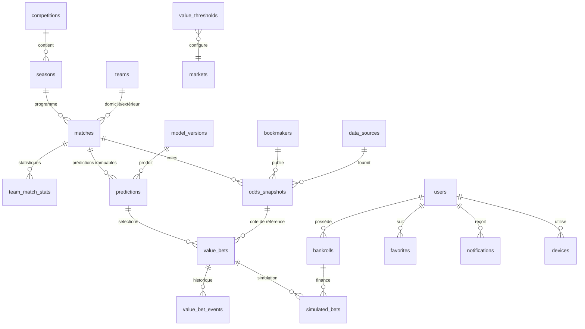

# 03 — Modèle de données

Version 1.0 — Phase 1. Le DDL de référence est dans `db/schema.sql` (cible PostgreSQL 16) : il n'a pas encore été exécuté, la validation par un moteur SQL est un prérequis de la Phase 2.

---

## 1. Principes

1. **Append-only sur les faits** : cotes, prédictions, événements d'opportunité et journal
   d'audit ne sont jamais mis à jour ni supprimés (triggers `RAISE EXCEPTION`).
2. **Séparation fait / état** : une prédiction est un fait daté ; l'opportunité courante est un
   état dérivé, recalculé, avec un historique d'événements.
3. **Traçabilité de source** : toute ligne de donnée externe porte `source_id`, `observed_at`
   et, pour les cotes, `source_payload_hash` (déduplication).
4. **Pas de suppression logique floue** : `deleted_at` uniquement pour les comptes utilisateurs,
   jamais pour les données sportives.
5. **Tout montant est `NUMERIC`**, jamais `FLOAT` (pas d'erreur d'arrondi sur la bankroll).
6. **Horodatages en `TIMESTAMPTZ`**, stockés en UTC. L'heure locale d'origine est conservée
   séparément (`kickoff_local`, `venue_timezone`).

---

## 2. Vue d'ensemble

---

## 3. Catalogue des tables

### 3.1 Référentiel sportif

| Table | Rôle | Points clés |
|---|---|---|
| `data_sources` | Fournisseurs et canaux | `code` unique, `license_ref`, `reliability_weight` 0–1 |
| `competitions` | Championnats | `country_code`, `logo_url`, `is_active` |
| `seasons` | Saisons | `label` (« 2026/2027 »), dates, `is_current` |
| `teams` | Clubs | `external_refs JSONB` (mapping multi-fournisseurs), `logo_url` |
| `players` | Joueurs | `team_id` nullable (transferts), `position`, `birth_date` |
| `venues` | Stades | `capacity`, `timezone`, `city` |
| `matches` | Rencontres | `kickoff_utc`, `kickoff_local`, `status`, `minute`, scores MT/FT, `data_quality_score` |
| `team_match_stats` | Stats par équipe et par match | xG, tirs, corners, cartons, possession ; PK `(match_id, team_id, source_id)` |
| `player_match_stats` | Stats joueurs | minutes, buts, tirs, passes, note |
| `injuries` | Blessures/suspensions | `status`, `expected_return`, `source_id` |
| `lineups` + `lineup_players` | Compositions | `is_official`, `published_at` ; composition probable ≠ officielle |

**Unicité métier** : `matches (source_id, source_event_id)` unique. Le mapping interne se fait par
`matches.id`, jamais par le nom d'équipe (les libellés changent : « Man United » / « Manchester
United » / « Man Utd »).

### 3.2 Marchés et cotes

| Table | Rôle | Points clés |
|---|---|---|
| `bookmakers` | Opérateurs | `access_channel` = `api` / `manual` / `partner`, `countries[]` |
| `markets` | Définition des marchés | `code` stable (`1X2`, `OU`, `BTTS`, `AH`, `DC`, `DNB`, `CS`, `HT_1X2`, `CORNERS_OU`, `CARDS_OU`, `PLAYER_GOALS`), `family`, `settlement_rules` |
| `odds_snapshots` | Toutes les cotes observées | Append-only, partitionné par mois, `decimal_odds NUMERIC(9,4)`, `is_verified`, `is_available`, `observed_at` |
| `odds_latest` (vue) | Dernière cote par sélection | `DISTINCT ON (match, bookmaker, market, line, selection)`, filtre fraîcheur |
| `odds_movements` (vue) | Variation ouverte → courante | delta, vitesse, direction, pour l'analyse de marché |

Convention de sélection (`selection_code`) :

| Marché | Codes |
|---|---|
| `1X2` | `HOME`, `DRAW`, `AWAY` |
| `DC` | `HOME_OR_DRAW`, `DRAW_OR_AWAY`, `HOME_OR_AWAY` |
| `DNB` | `HOME`, `AWAY` |
| `OU` | `OVER`, `UNDER` (la ligne porte 2.5, 3.5…) |
| `BTTS` | `YES`, `NO` |
| `AH` | `HOME`, `AWAY` (la ligne porte −1.25, +0.75…) |
| `CS` | `1-0`, `2-1`, `OTHER`… |
| `HT_1X2` | `HOME`, `DRAW`, `AWAY` (mi-temps) |
| `CORNERS_OU` | `OVER`, `UNDER` (ligne 9.5) |

Une cote `manual` est marquée `is_verified = true` uniquement si l'utilisateur atteste l'avoir
vue ; sinon `is_verified = false` et elle ne peut pas générer de recommandation `A`/`B`.

### 3.3 Modèles et prédictions

| Table | Rôle | Points clés |
|---|---|---|
| `model_versions` | Versions entraînées | `status` (`candidate`/`active`/`archived`), métriques JSONB (Brier, log loss, ECE par marché), `artifact_uri`, `checksum`, `parent_id` |
| `predictions` | Fait immuable | `(match_id, model_version_id, market_code, line, selection_code)` + probabilité, IC bas/haut, qualité de données, `features_hash`, `prev_hash`, `row_hash` |
| `prediction_contexts` | Photo des entrées | JSONB versionné des features utilisées (sans données futures) |
| `calibration_bins` | Courbes de calibration | par modèle, marché, période |

**Immuabilité** : trigger `predictions_no_mutation` (UPDATE/DELETE interdits). La correction d'une
prédiction erronée consiste à **insérer** une nouvelle prédiction avec un `supersedes_id`.

**Chaîne de hachage** : `row_hash = SHA256(canonical_json(prédiction) || prev_hash)`. Un job
quotidien vérifie l'intégrité de la chaîne et alerte en cas de rupture.

### 3.4 Value Betting

| Table | Rôle | Points clés |
|---|---|---|
| `value_bets` | Opportunité calculée | `odds_snapshot_id`, `implied_prob_novig`, `fair_odds`, `ev`, `edge`, `score`, `priority`, `gate_results JSONB`, `explanation JSONB`, `status` |
| `value_bet_events` | Cycle de vie | `created`, `upgraded`, `downgraded`, `expired`, `withdrawn`, `settled` ; append-only |
| `value_thresholds` | Seuils par marché | `min_ev`, `min_ci_low`, `max_margin`, `min_data_quality`, `min_odds`, `max_odds`, `max_age_seconds` |
| `market_calibration_stats` | Performance historique par marché | Brier, log loss, ECE, ROI simulé, échantillon, période |

`value_bets` contient **le résultat du calcul**, pas la règle. La règle est versionnée dans
`value_thresholds` (`valid_from`, `valid_to`), ce qui permet de rejouer un backtest avec les
seuils de l'époque.

### 3.5 Utilisateurs, simulation, notifications

| Table | Rôle |
|---|---|
| `users` | Compte, e-mail (unique, insensible à la casse), hash Argon2id, statut, `deleted_at` |
| `roles`, `permissions`, `role_permissions`, `user_roles` | RBAC |
| `refresh_tokens` | Rotation, révocation, empreinte appareil (pas le token en clair) |
| `devices` | FCM token, plateforme, dernière activité |
| `favorites` | `(user_id, entity_type, entity_id)` unique |
| `bankrolls` | Capital simulé, `kelly_fraction` (0–0.5), plafonds, `is_active` |
| `simulated_bets` | Mise, cote prise, statut, paiement, P&L, cote de clôture, CLV |
| `notifications` | File et historique d'envoi (statut FCM) |
| `notification_preferences` | Type, activé, priorité minimale, heures calmes |
| `audit_logs` | Append-only : acteur, action, cible, IP, résultat |
| `ingestion_runs` | Trace de chaque collecte : source, durée, volumes, erreurs |
| `provider_health` | Dernier succès, latence, taux d'erreur, quota restant |
| `raw_payloads` | Payload brut compressé + hash (rétention 7 jours, preuve d'origine) |
| `system_settings` | Paramètres globaux versionnés |

---

## 4. Invariants vérifiés en base

| # | Invariant | Moyen |
|---|---|---|
| I1 | Une cote est > 1.00 | `CHECK (decimal_odds > 1)` |
| I2 | Une probabilité est dans ]0,1[ | `CHECK (probability > 0 AND probability < 1)` |
| I3 | Une ligne de marché est un multiple de 0.25 (handicaps/totaux) | vérifié à l'ingestion + `CHECK (line IS NULL OR (line * 4)::numeric = trunc(line * 4))` |
| I4 | Une prédiction ne peut pas être modifiée | trigger |
| I5 | Une cote ne peut pas être modifiée | trigger |
| I6 | Une opportunité référence une cote et une prédiction | FK `NOT NULL` |
| I7 | Une mise simulée est positive et ≤ bankroll | `CHECK`, trigger applicatif |
| I8 | Un utilisateur supprimé ne peut plus se connecter | `deleted_at IS NULL` dans la requête d'auth |
| I9 | Un match ne peut pas opposer une équipe à elle-même | `CHECK (home_team_id <> away_team_id)` |
| I10 | `kickoff_utc` est cohérent avec `kickoff_local` + fuseau | contrôle d'ingestion, test dédié |

---

## 5. Partitionnement et rétention

| Table | Partition | Rétention | Justification |
|---|---|---|---|
| `odds_snapshots` | `RANGE (captured_at)` mensuel | 24 mois chaud, archive froide (Parquet) au-delà | Volume principal (≈ 1–5 M lignes/mois) |
| `predictions` | Aucune (croissance modérée) | illimitée | Audit et backtest |
| `audit_logs` | `RANGE (created_at)` mensuel | 12 mois | Conformité, coût |
| `raw_payloads` | — | 7 jours | Preuve d'origine, taille |
| `notifications` | — | 6 mois | Historique utilisateur |

Index critiques : `(match_id, kickoff_utc)`, `(match_id, market_code, selection_code, captured_at DESC)`,
`(priority, score DESC) WHERE status='active'`, `(user_id, created_at DESC)`.

---

## 6. Données personnelles

- Collecte minimale : e-mail, mot de passe hashé, préférences, appareils, bankroll simulée.
- Pas de nom réel, pas de téléphone, pas de données de paiement.
- Suppression de compte : anonymisation (e-mail remplacé par hash), conservation des agrégats
  anonymes de performance, suppression des favoris/notifications/bankrolls.
- Export : JSON des données utilisateur sous 30 jours.
- Aucune donnée personnelle dans les payloads fournisseurs ou les logs.

---

## 7. Ce que le modèle interdit

- Stocker une cote « actuelle » sans historique (l'historique est la table de base).
- Écraser une prédiction pour « corriger » un affichage.
- Créer une opportunité sans prédiction et sans cote vérifiée.
- Enregistrer un combiné comme un simple produit de probabilités : la table `simulated_bets`
  référence une `value_bet` par sélection, et le regroupement passe par `bet_slips` (phase 5,
  voir `docs/07` §8).
- Supprimer un utilisateur physiquement sans anonymisation.
